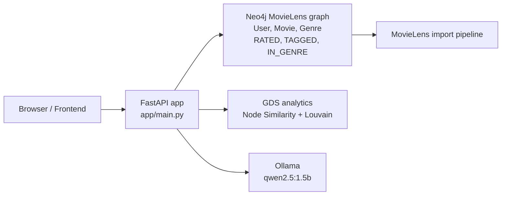
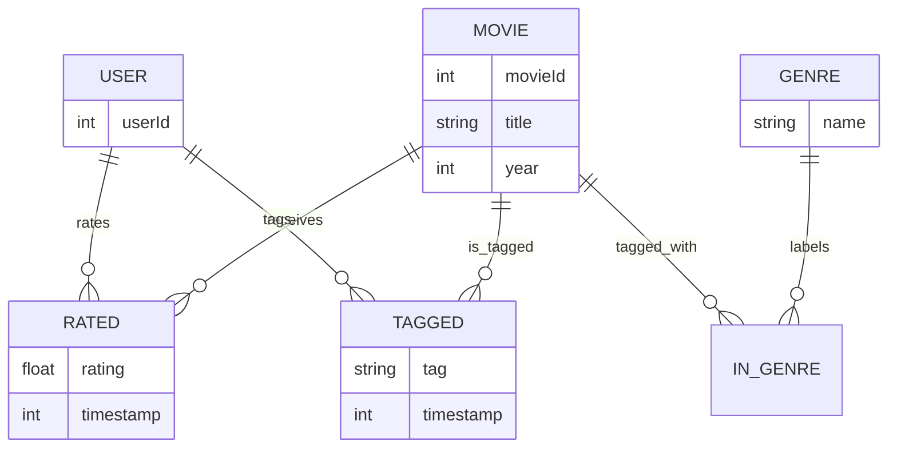

# The Screening Room

The Screening Room is a Python-based movie recommendation application built on FastAPI, Neo4j, and the MovieLens latest-small dataset. The project is a graph-first recommendation and analytics application for exploring movie similarity, user communities, shortest-path relationships, and a read-only movie assistant.

## Verified Part 1 features

The following capabilities are implemented and verified in the current project state:

- Neo4j MovieLens ingestion and graph schema setup
- FastAPI endpoints for recommendations, pathfinding, and analytics
- GDS projection creation using the official Neo4j Graph Data Science plugin
- User similarity using GDS node similarity
- Community detection using GDS Louvain
- Shortest-path queries for user-to-user and user-to-movie paths
- Read-only movie assistant with allowlisted Cypher templates and Ollama integration
- Responsive frontend served from the root path
- Test coverage, lint validation, and Docker startup verification

## Implemented Part 2 features

The Screening Room has been extended beyond the initial recommendation engine into an interactive movie discovery and community platform.

The additional features include:

- User profiles and personalized movie discovery
- Movie search and TMDb integration
- Community and film society features
- Expanded recommendation and graph analytics services
- Interactive frontend with HTML, CSS, and JavaScript
- Additional FastAPI endpoints supporting platform features
- Extended automated test suite covering profiles, analytics, recommendations, and TMDb integration

These features build on the original Neo4j graph database, recommendation algorithms, GDS analytics, and AI assistant.


## Architecture



The browser calls the FastAPI application for homepage rendering, recommendations, graph analytics, and assistant queries. Neo4j stores the MovieLens graph and the GDS projection. The assistant service calls a local Ollama instance for classification, but only uses allowlisted read-only Cypher templates.

## Graph schema



Core entities:

- User: a MovieLens user node with a unique userId
- Movie: a title, year, and unique movieId
- Genre: a movie genre label such as Comedy, Drama, or Sci-Fi
- Relationships:
  - RATED: user -> movie with rating and timestamp
  - TAGGED: user -> movie with tag and timestamp
  - IN_GENRE: movie -> genre

## Project structure

- app/: FastAPI application code and frontend assets
- database/scripts/: MovieLens import and verification scripts
- tests/: automated tests
- documentation/: architecture and project notes
- notebooks/: demo and exploratory notebooks
- data/: local dataset storage and generated outputs

## Setup and environment

### Windows PowerShell

1. Install Python 3.13.
2. Install Docker Desktop and enable Linux containers.
3. Clone the repository and open it in VS Code.
4. Create a virtual environment:
   python -m venv .venv
5. Activate the environment:
   .\.venv\Scripts\Activate.ps1
6. Install dependencies:
   python -m pip install -r requirements.txt
7. Copy the example environment file:
   Copy-Item .env.example .env
8. Review .env and update local values if needed.
9. Start the stack:
   docker compose up --build

### Local service startup

When running the app directly on a Windows host, use the local Neo4j and Ollama addresses:

- Neo4j: bolt://localhost:7687
- Ollama: http://localhost:11434

Inside Docker Compose, the app connects to the internal service addresses:

- Neo4j: bolt://neo4j:7687
- Ollama: http://ollama:11434

### Environment variables

The application expects these variables in the environment or in .env:

- NEO4J_URI
- NEO4J_USER
- NEO4J_PASSWORD
- NEO4J_DATABASE
- OLLAMA_BASE_URL
- OLLAMA_MODEL
- APP_HOST
- APP_PORT

The .env example file contains placeholders only. Do not add real credentials to source control.

## MovieLens import

The project includes a standard MovieLens import pipeline in [database/scripts/import_movielens.py](database/scripts/import_movielens.py).

### Import process

1. Load Movies, Ratings, and Tags CSV files from the local MovieLens dataset.
2. Create unique constraints for User, Movie, and Genre nodes.
3. Merge each Movie and its Genre labels.
4. Merge User nodes and RATED relationships with movie ratings.
5. Merge TAGGED relationships for user-created tags.

### PowerShell import steps

From the project root:

1. Activate the environment:
   .\.venv\Scripts\Activate.ps1
2. Set the Neo4j password for your session if needed:
   $env:NEO4J_PASSWORD="change_me"
3. Run the importer:
   python .\database\scripts\import_movielens.py
4. Verify the graph:
   python .\database\scripts\verify_import.py

### Import verification output

The validation script reports expected totals such as:

- total users
- total movies
- total genres
- total rated relationships
- total tagged relationships
- sample movie records

This verifies that the graph was populated correctly and matches the expected MovieLens dataset structure.

## API endpoints

The FastAPI service exposes the following verified routes:

- GET /health — service health check
- GET /recommendations/popular?limit=10 — popular movies by average rating and count
- GET /recommendations/hidden-gems?limit=10 — highly rated movies with relatively few ratings
- GET /recommendations/similar/{movie_id}?limit=10 — similar movies using shared genres and audience overlap
- GET /recommendations/personalized/{user_id}?limit=10 — collaborative filtering with fallback
- GET /analytics/similar-users/{user_id}?limit=5 — GDS node-similarity user scores
- GET /analytics/communities?limit=10 — GDS Louvain communities
- GET /analytics/path/users/{user_id_1}/{user_id_2} — shortest user-to-user path
- GET /analytics/path/user-movie/{user_id}/{movie_id} — shortest user-to-movie path
- POST /assistant/ask — allowlisted question-to-query assistant

### Local FastAPI run

From the project root:

1. Activate the environment:
   .\.venv\Scripts\Activate.ps1
2. Start the service:
   uvicorn app.main:app --reload --host 0.0.0.0 --port 8000
3. Open the website:
   http://localhost:8000/
4. Open the API docs:
   http://localhost:8000/docs

## Recommendation algorithms

The recommendation service uses the imported graph structure and keeps the logic readable and beginner-friendly.

### Popular movies

The popular list ranks movies by:

- average rating
- rating count
- minimum threshold of 20 ratings

This is a historical popularity view based on MovieLens ratings, not a live trending feed.

### Hidden gems

The hidden-gem query looks for movies with:

- strong average rating
- relatively low rating volume
- minimum rating count threshold to avoid unstable results

### Similar movies

The similar-movie query blends:

- Jaccard-style genre similarity
- audience overlap among raters

It returns a weighted similarity score and explanatory text.

### Personalized recommendations

The personalized recommendation logic:

- compares a target user to similar users
- identifies unseen candidates rated by those users
- uses similarity-adjusted ratings as the scoring signal
- falls back to highly rated unrated movies when collaborative evidence is weak or absent

## GDS projection and algorithms

The project uses the official Neo4j GDS plugin for in-memory graph analytics.

### Neo4j Compose configuration

The Neo4j container is configured with:

- NEO4J_PLUGINS: ["graph-data-science"]
- NEO4J_dbms_security_procedures_unrestricted: "gds.*"

The projection name used by the app is:

- screening-room-ratings

### Graph projection

The app creates an in-memory projection over User and Movie nodes using an undirected RATED relationship. This supports:

- node similarity analysis
- Louvain community detection
- path exploration on the data model

### GDS node similarity

The similar-users endpoint uses GDS nodeSimilarity.stream and ranks users by the highest similarity score after deduplication.

### GDS Louvain

The communities endpoint calls GDS Louvain and returns community membership as a sorted list of user IDs grouped by community.

## Pathfinding

The graph analytics layer supports read-only shortest-path queries over RATED relationships. The maximum search depth is bounded at 6 hops, and the database is never mutated as part of pathfinding.

Endpoints:

- GET /analytics/path/users/{user_id_1}/{user_id_2}
- GET /analytics/path/user-movie/{user_id}/{movie_id}

A path result includes:

- found flag
- ordered list of nodes
- ordered list of relationships
- hop count
- explanatory message when no path is found

## Ollama AI assistant

The assistant is implemented and configured to use the local Ollama model qwen2.5:1.5b.

### Supported allowlisted query templates

The assistant does not generate raw Cypher. It selects from five fixed templates:

1. popular_movies
2. top_genre_movies
3. movie_details
4. user_recommendations
5. popular_tags

Each template is validated before execution and must exactly match an approved query pattern.

### Safety safeguards

The assistant enforces these safety checks:

- Questions must be non-empty strings
- limit must be between 1 and 25
- movie_id and user_id must be positive integers
- genre values must come from the known MovieLens genre list
- only read-only Neo4j access is used
- comments and multiple Cypher statements are rejected
- arbitrary or unapproved queries are rejected
- unknown questions return a clear error instead of exposing database internals

### Assistant request example

```json
{
  "question": "Find five highly rated comedy movies"
}
```

The execution path is:

- FastAPI receives the request
- assistant validates the question
- Ollama classifies the intent and normalized parameters
- app validates the selected template and parameters
- Neo4j runs the read-only query
- results are returned in a safe JSON payload

## Frontend and demo usage

The app serves a responsive movie-club landing page at the root path. The front end uses HTML, CSS, and vanilla JavaScript and communicates with the same FastAPI endpoints used by the API.

Example browser calls:

- http://localhost:8000/
- http://localhost:8000/recommendations/popular?limit=5
- http://localhost:8000/recommendations/hidden-gems?limit=5
- http://localhost:8000/recommendations/personalized/1?limit=5
- http://localhost:8000/analytics/similar-users/1?limit=5
- http://localhost:8000/analytics/communities?limit=10

## Demo and troubleshooting

### Demo notebook

A lightweight notebook is available at [notebooks/demo.ipynb](notebooks/demo.ipynb). It demonstrates:

- node and relationship count checks
- popular and hidden-gem API calls
- personalized recommendations
- similar users and communities
- shortest-path requests
- assistant requests to POST /assistant/ask

### Docker troubleshooting

If the stack is not ready:

1. Check that Docker Desktop is running.
2. Confirm the containers are up:
   docker ps
3. View logs for the app container:
   docker logs screening-room-app
4. View Neo4j logs if the import or graph layer is failing:
   docker logs screening-room-neo4j
5. Confirm the app is healthy:
   http://localhost:8000/health
6. Confirm Swagger docs are reachable:
   http://localhost:8000/docs

### PowerShell troubleshooting

If the local app fails to start:

1. Activate the environment.
2. Confirm .env variables are present.
3. Verify the Neo4j password is set in the active shell.
4. Starting the app locally:
   uvicorn app.main:app --reload --host 0.0.0.0 --port 8000
5. Confirm the app is serving the frontend at:
   http://localhost:8000/

## Verification baseline

The completed project has been verified with:

- 75 passing automated tests
- 68% overall code coverage
- Pylint score of 9.64/10
- Successful Docker Compose startup
- Working FastAPI Swagger documentation
- Successful AI assistant API request (HTTP 200)
- GitHub development branch, pull request, and merge


## Current limitations and future improvements

The Screening Room is a functional movie discovery and community platform built using historical MovieLens data.

Current limitations include:

- Recommendations are primarily based on historical ratings rather than real-time viewing activity.
- The dataset contains 610 users and 9,742 movies, limiting the scale of community analysis.
- The AI assistant uses five predefined, read-only Cypher query templates rather than unrestricted database queries.
- TMDb provides additional movie information, while MovieLens remains the main recommendation dataset.
- The application is designed as an academic prototype rather than a production-ready commercial platform.

Potential future improvements include real-time recommendations, larger datasets, richer social interactions, and more advanced AI-powered discovery.


## Additional documentation

- [documentation/architecture.md](documentation/architecture.md)
- [notebooks/demo.ipynb](notebooks/demo.ipynb)

## Notes

- Do not commit real credentials or production secrets.
- The environment template contains placeholders only.
- The app remains read-only for the assistant and pathfinding workflows.
- Implementation scope is deliberately limited to verified Part 1 features.
