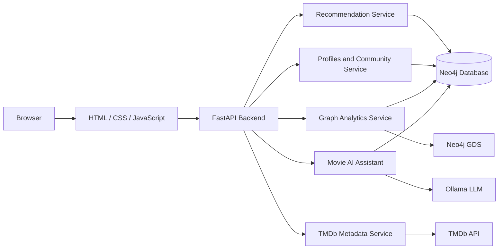
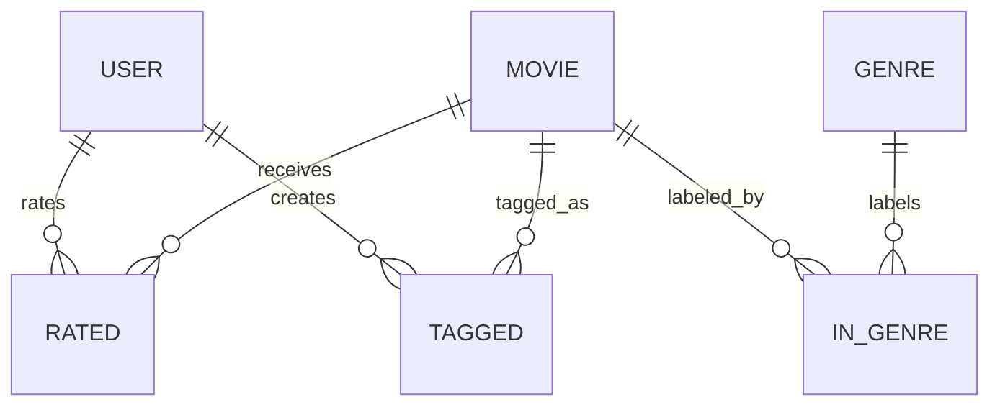

# The Screening Room architecture

## Overview

The Screening Room is a graph-backed movie recommendation system built around Neo4j, FastAPI, and a local Ollama integration. The platform ingests the MovieLens latest-small dataset, models the relationships in a graph database, exposes read-only recommendation and analytics endpoints, and finally serves a lightweight frontend at the root URL.

The project was initially developed as a graph-based recommendation engine (Part 1) and subsequently extended into a movie discovery and community platform (Part 2).

The completed application combines:

- Neo4j graph-based movie recommendations and analytics
- FastAPI backend services and REST endpoints
- User profiles and personalized movie discovery
- Film society and community features
- TMDb integration for additional movie information
- Interactive HTML, CSS, and JavaScript frontend
- Ollama-powered movie assistant with safe, read-only Cypher templates

The architecture separates database access, recommendation logic, graph analytics, user profiles, external movie metadata, and API routing into dedicated services.

## Runtime architecture

The app is served by FastAPI and exposes both API routes and a root landing page. The application layer reads from Neo4j, creates or reuses the in-memory GDS projection, and delegates intent classification to Ollama only for the movie assistant workflow.

## Graph data model

The graph store contains the primary MovieLens entities:

- User nodes keyed by userId
- Movie nodes keyed by movieId
- Genre nodes keyed by genre name
- RATED relationships between users and movies
- TAGGED relationships between users and movies
- IN_GENRE relationships between movies and genres

### Relationship semantics

- RATED stores a rating value and timestamp;
- TAGGED stores tag text and timestamp;
- IN_GENRE links each movie to its genre labels;
- Graph traversal is read-only for all recommendation and analytics endpoints.

## Import pipeline

The project imports movie, rating, and tag data from the local MovieLens dataset into Neo4j. The importer creates unique constraints and indexes for the main entities, then merges rows into the graph using the Neo4j MERGE pattern so the import is idempotent when repeated.

The main phases are:

1. ensure schema and indexes exist
2. import movies and their genre edges
3. import ratings and user/movie connections
4. import tags and user-to-movie tagging edges
5. validate counts and sample records

This stage is intentionally deterministic and historical. It is not a social-network layer.

## Recommendation methods

The app exposes several recommendation methods built from the graph data:

- popular movies: average rating and rating count with historical popularity weighting
- hidden gems: strong ratings with fewer ratings and a minimum threshold
- similar movies: shared genres plus audience overlap
- personalized recommendations: collaborative filtering with a fallback for highly rated unseen titles

These methods intentionally rely on known MovieLens rating data. They do not model future user behavior, social influence, or real-time trends.

## GDS projection and analytics

The Neo4j deployment includes the official Graph Data Science plugin. The application creates an in-memory projection named screening-room-ratings over User and Movie nodes, using the RATED relationship as an undirected edge.

This enables:

- node similarity for similar users
- Louvain community detection for user communities
- shortest-path analysis across user-user and user-movie paths

The GDS layer is intentionally best-effort; if the plugin is unavailable, the service returns empty results rather than failing the app.

## Pathfinding behavior

The analytics service runs read-only shortest-path queries using Neo4j shortestPath with a maximum hop count of 6 over RATED relationships.

Two path types are available:

- user-to-user path
- user-to-movie path

The response contains:

- found status
- ordered path nodes
- relationship metadata
- hop count
- not-found message when the path is absent

## Assistant design

The assistant is implemented as a strict allowlist pattern. It never accepts raw Cypher from the model. Instead, the LLM classifies the user’s question into one of five approved intents and returns normalized parameters.

The five allowlisted intents are:

- popular_movies
- top_genre_movies
- movie_details
- user_recommendations
- popular_tags

The assistant validates:

- non-empty question strings
- integer bounds for limits and IDs
- known MovieLens genre names
- only read-only GraphDatabase access
- rejection of multiple statements, comments, and unapproved templates

This keeps the assistant safe and predictably bounded while still enabling natural-language queries over the graph.

## Frontend and API surface

The FastAPI app runs the main API and serves the homepage at the root. The UI is intentionally lightweight and static, with browser calls to the same API endpoints used by backend integrations.

The main API categories include:

- recommendation endpoints
- analytics endpoints
- assistant endpoint
- health check

## Main design limitations

This Part 1 implementation intentionally does not include:

- social graph relationships beyond MovieLens user-rating links
- live recommendation adaptation based on user activity
- authentication and authorization layers
- production-grade LLM orchestration and memory management
- full business intelligence dashboards or deployment automation beyond the current stack

The project is therefore a verified graph-based recommendation and analytics baseline, not a full social-media recommendation platform.

## Verified status

The completed Screening Room application has:

- 75 passing automated tests
- 68% code coverage
- Pylint score of 9.64/10
- Working Docker Compose deployment
- Functional FastAPI and AI assistant endpoints
- Implemented movie discovery and community features
- GitHub version control with branches and a merged pull request
